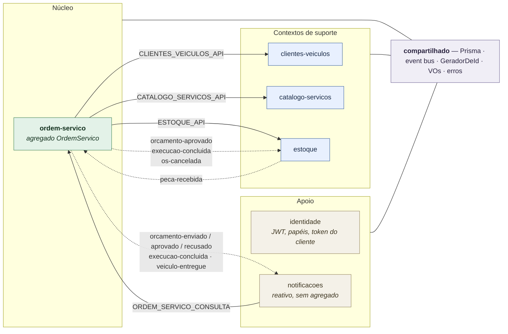
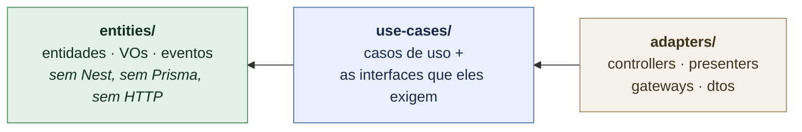
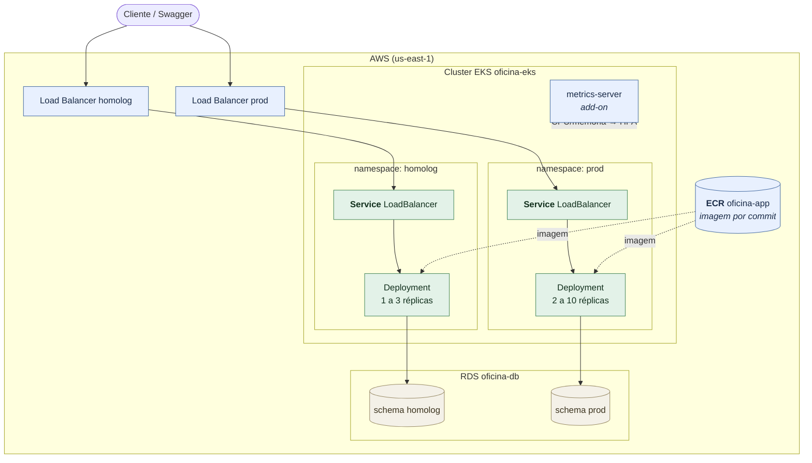
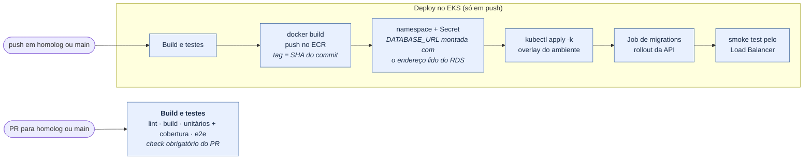
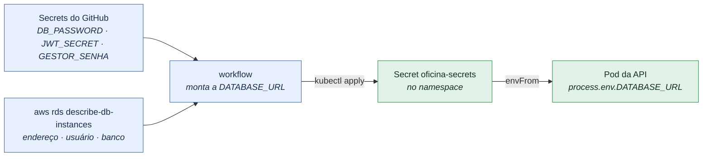

# Sistema de Oficina — Back-end

Back-end do Sistema de Atendimento e Execução de Serviços de uma oficina mecânica:
cadastro de clientes/veículos, **Ordem de Serviço** (diagnóstico → orçamento → execução →
entrega), controle de **estoque de peças** e acompanhamento do cliente com login por CPF.

**Stack:** TypeScript · NestJS 11 · PostgreSQL 16 + Prisma 5 · JWT · Swagger.
**Infraestrutura:** Docker · AWS (EKS, ECR, RDS) · Kustomize · Terraform · GitHub Actions.

---

## Entregáveis da Fase 2

| Item | Onde |
|---|---|
| Descrição da solução e objetivos desta fase | [Objetivos](#objetivos) |
| Desenho da arquitetura — componentes da aplicação | [Arquitetura](#arquitetura) |
| Desenho da arquitetura — infraestrutura provisionada | [Componentes](#componentes) |
| Desenho da arquitetura — fluxo de deploy | [Fluxo de deploy](#fluxo-de-deploy) |
| Instruções de execução local | [Rodando localmente](#rodando-localmente) |
| Instruções de deploy (Fase 3: EKS) | [Infraestrutura (Fase 3)](#infraestrutura-fase-3) |
| Collection completa das APIs | [Collection das APIs](#collection-das-apis) |
| Vídeo demonstrativo | [Vídeo demonstrativo](#vídeo-demonstrativo) |

---

## Objetivos

Digitalizar o atendimento de uma oficina mecânica, do recebimento do veículo à entrega,
concentrando as regras de negócio no agregado **Ordem de Serviço**:

- **Cadastros:** clientes, veículos, serviços e peças (com saldo de estoque).
- **Ordem de Serviço ponta a ponta:** recebimento → diagnóstico → orçamento → aprovação do
  cliente → execução → finalização → pagamento → entrega, com uma **máquina de estados** que
  rejeita transições inválidas (HTTP 422).
- **Orçamento com preço congelado** (snapshot no diagnóstico) e **vários orçamentos por OS**: um
  inicial e adicionais para reparos descobertos durante a execução.
- **Estoque e cotação:** peça disponível é reservada na aprovação; peça em falta é **encomendada**,
  a OS fica em *Aguardando peça* e **retoma a execução automaticamente** quando a peça dá entrada.
- **Fila de trabalho** (`GET /ordens-servico/fila`): OS ativas ordenadas por prioridade de status,
  mais antigas primeiro, sem as finalizadas/entregues.
- **Acompanhamento do cliente** com login por CPF: listar as próprias OSs, consultar o status e aprovar/recusar
  orçamentos sem login de operador.
- **Notificações** ao cliente disparadas por evento (ex.: orçamento enviado).

Na **Fase 2**, a mesma aplicação ganha a infraestrutura que a sustenta em escala:

- **Clean Architecture** em todos os módulos, com a regra de dependência apontando para dentro.
- **Containerização** revisada: imagem multi-stage, usuário sem privilégios, migrations fora do start.
- **Orquestração em Kubernetes**: Deployment, Service, ConfigMap, Secrets, Job e **HPA**
  (escala automática por CPU/memória).
- **Infraestrutura como código** com Terraform: namespace, segredos e banco de dados provisionados
  por comando, não à mão.
- **CI/CD** no GitHub Actions: build, testes, imagem Docker e deploy verificado num cluster real.

---

## Rodando localmente

O ambiente completo — API e Postgres — sobe com **um comando**. Não é preciso Node,
Postgres nem nada além do Docker na máquina.

### Pré-requisitos

| | |
|---|---|
| **Obrigatório** | Docker Engine com o plugin `docker compose` (v2) |

Confirme antes de começar:

```bash
docker --version           # Docker version 28.x
docker compose version     # Docker Compose version v2.x
```

### Passo 1 — Clonar o repositório

```bash
git clone git@github.com:madurubini/workshop-manager.git
cd workshop-manager
```

### Passo 2 — Subir o ambiente

```bash
docker compose up --build          # em segundo plano: docker compose up --build -d
```

O primeiro build leva alguns minutos (instala dependências e compila). Nas vezes seguintes o
Docker reaproveita o cache e sobe em segundos.

Três coisas acontecem no start, nesta ordem (script `docker-entrypoint.sh`):

1. **`prisma migrate deploy`** — cria as tabelas a partir de `prisma/migrations/`;
2. **`node dist/prisma/seed.js`** — popula usuário, serviços e peças de exemplo. É idempotente:
   pode subir quantas vezes quiser sem duplicar nada;
3. **`node dist/main`** — sobe a API.

Está pronto quando aparecer no log:

```
Nest application successfully started
API ouvindo em http://localhost:3000/api/v1
Swagger em http://localhost:3000/api/docs
```

### Passo 3 — Conferir que está no ar

```bash
docker compose ps
# oficina-app e oficina-db devem estar "Up" e "(healthy)"

curl http://localhost:3000/api/v1/health
# {"status":"ok","info":{"database":{"status":"up"}}, ...}
```

`"database":"up"` é a prova de que a API alcançou o Postgres.

### Passo 4 — Fazer login

O seed criou um usuário administrativo:

```bash
curl -s -X POST http://localhost:3000/api/v1/auth/login \
  -H 'Content-Type: application/json' \
  -d '{ "username": "gestor", "senha": "gestor123" }'
# { "accessToken": "eyJhbGciOi...", "expiresIn": 3600 }
```

Guarde o token para as chamadas autenticadas:

```bash
TOKEN=$(curl -s -X POST http://localhost:3000/api/v1/auth/login \
  -H 'Content-Type: application/json' \
  -d '{ "username": "gestor", "senha": "gestor123" }' | jq -r .accessToken)
```

Daqui, siga para o [Passeio de 2 minutos](#passeio-de-2-minutos-fluxo-completo-via-curl),
que percorre uma OS do recebimento à entrega — ou abra o Swagger e explore pela interface.

### Onde fica cada coisa

| Recurso | Endereço |
|---|---|
| API (base das rotas) | http://localhost:3000/api/v1 — prefixo global; a raiz não é rota, use os caminhos abaixo |
| Swagger | http://localhost:3000/api/docs |
| OpenAPI JSON | http://localhost:3000/api/docs-json |
| Health check | http://localhost:3000/api/v1/health |
| Postgres (no host) | `localhost:5433` — usuário `oficina`, senha `oficina`, banco `oficina` |

> A porta **5433** é usada de propósito no host, porque a 5432 costuma estar ocupada por outro
> Postgres. Dentro da rede do compose a API fala com o banco em `db:5432`.

### Comandos do dia a dia

```bash
docker compose logs -f app     # acompanhar os logs da API
docker compose ps              # estado dos containers e health
docker compose restart app     # reiniciar só a API
docker compose down            # parar tudo, mantendo os dados no volume
docker compose down -v         # parar e APAGAR o banco (volume oficina-pgdata)
```

Para recomeçar do zero, com o banco limpo:

```bash
docker compose down -v && docker compose up --build
```

### Configuração

Os valores usados pelo compose têm padrões de desenvolvimento e podem ser sobrescritos por um
arquivo `.env` na raiz — use o [`.env.example`](.env.example) como base:

```bash
cp .env.example .env
```

| Variável | Padrão | Para quê |
|---|---|---|
| `POSTGRES_USER` / `POSTGRES_PASSWORD` / `POSTGRES_DB` | `oficina` | Credenciais do Postgres |
| `POSTGRES_PORT` | `5433` | Porta do banco no host |
| `APP_PORT` | `3000` | Porta da API no host |
| `JWT_SECRET` | segredo de desenvolvimento | Assinatura dos tokens |
| `JWT_EXPIRES_IN` | `3600s` | Validade do token |
| `NEW_RELIC_ENABLED` / `NEW_RELIC_LICENSE_KEY` | `false` / vazio | Liga o agente do New Relic com a sua conta ([observabilidade](docs/observabilidade.md)) |

---

## Autenticação

O seed cria um usuário administrativo e dados de exemplo (2 serviços e 2 peças — uma com saldo e
uma em falta, para exercitar a cotação/encomenda):

| username | senha       | papel  |
|----------|-------------|--------|
| `gestor` | `gestor123` | GESTOR |

A senha vem de `SEED_GESTOR_SENHA`; `gestor123` é o padrão do `docker-compose`, só para uso local.
Na nuvem ela vem do secret `GESTOR_SENHA` do GitHub, e o seed não roda sem ela.

```bash
TOKEN=$(curl -s -X POST http://localhost:3000/api/v1/auth/login \
  -H 'Content-Type: application/json' \
  -d '{ "username": "gestor", "senha": "gestor123" }' | jq -r .accessToken)
```

Use o token nas rotas administrativas: `Authorization: Bearer $TOKEN`. Novos usuários são criados
por um GESTOR via `POST /usuarios` (`{ username, senha, papel }`).

No Swagger, clique em **Authorize** e cole o `accessToken` para testar as rotas pelo navegador.

**Cliente.** As rotas de `/acompanhamento` exigem o **token do cliente**, emitido pelo login por
CPF (Lambda `auth-cpf`, repo `oficina-lambda-auth`): `{ sub: clienteId, papel: "CLIENTE" }`,
assinado com o mesmo `JWT_SECRET`. O cliente só enxerga as próprias OSs, e o token dele não abre
rotas administrativas (403). Sem a Lambda, rodando localmente, dá para gerar o mesmo token dentro
do container (veja o passo 5 do passeio abaixo).

---

## Passeio de 2 minutos (fluxo completo via curl)

Com a API no ar e o `$TOKEN` do passo anterior (os exemplos usam `jq` para ler o JSON). Os ids de
serviço e peça vêm do seed. **Documento e placa são únicos** — se repetir a execução, troque os
valores ou recrie o banco (`docker compose down -v`), senão vem `409 CONFLITO`.

```bash
API=http://localhost:3000/api/v1
AUTH="Authorization: Bearer $TOKEN"
JSON="Content-Type: application/json"

# 1. Cliente e veículo
CLIENTE=$(curl -s -X POST $API/clientes -H "$AUTH" -H "$JSON" \
  -d '{ "documento": "11144477735", "nome": "Ana Souza" }' | jq -r .id)

VEICULO=$(curl -s -X POST $API/clientes/$CLIENTE/veiculos -H "$AUTH" -H "$JSON" \
  -d '{ "placa": "RTY7H21", "marca": "Ford", "modelo": "Ka", "ano": 2020 }' | jq -r .id)

# 2. Abrir a OS → "Recebida"
OS=$(curl -s -X POST $API/ordens-servico -H "$AUTH" -H "$JSON" \
  -d "{ \"clienteId\": \"$CLIENTE\", \"veiculoId\": \"$VEICULO\",
        \"problemaRelatado\": \"Barulho na suspensão\" }" | jq -r .id)

# 3. Iniciar o diagnóstico → "Em diagnóstico"
curl -s -X POST $API/ordens-servico/$OS/diagnostico/iniciar -H "$AUTH" | jq -r .status

# 4. Registrar itens e concluir o diagnóstico → orçamento gerado E enviado ao cliente
#    (11111111… = "Troca de óleo" R$ 120; 33333333… = "Filtro de óleo" R$ 35 — ambos do seed)
#    → status "Aguardando aprovação", total 190
ORCAMENTO=$(curl -s -X POST $API/ordens-servico/$OS/diagnostico -H "$AUTH" -H "$JSON" \
  -d '{ "servicos": [{ "servicoId": "11111111-1111-4111-8111-111111111111", "quantidade": 1 }],
        "pecas":    [{ "pecaId":    "33333333-3333-4333-8333-333333333333", "quantidade": 2 }] }' \
  | jq -r .orcamento.id)

# 5. O cliente entra com o CPF. Na nuvem quem emite o token é a Lambda auth-cpf; localmente,
#    geramos o mesmo token dentro do container (mesmo JWT_SECRET, mesmo formato):
TOKEN_CLIENTE=$(docker compose exec -T app node -e "console.log(require('jsonwebtoken').sign(
  { sub: process.argv[1], papel: 'CLIENTE' }, process.env.JWT_SECRET, { expiresIn: '1h' }))" "$CLIENTE")
CLI="Authorization: Bearer $TOKEN_CLIENTE"

curl -s $API/acompanhamento -H "$CLI" | jq -c '.[] | { id, numero, status }'   # as OSs dele
curl -s $API/acompanhamento/$OS -H "$CLI" | jq '{ status, total: .orcamentos[0].total }'

# 6. Cliente aprova o orçamento → "Em execução" (e o estoque reserva as peças)
curl -s -X POST $API/acompanhamento/$OS/orcamentos/$ORCAMENTO/resposta \
  -H "$CLI" -H "$JSON" -d '{ "aprovado": true }' | jq -r .status

# 7. Fila de trabalho (a OS aparece nela enquanto está ativa) e reserva no estoque
curl -s $API/ordens-servico/fila -H "$AUTH" | jq -c '.[] | { numero, status }'
curl -s $API/pecas/33333333-3333-4333-8333-333333333333 -H "$AUTH" | jq -c '{ saldoFisico, reservado }'
# → num banco recém-semeado: {"saldoFisico":10,"reservado":2} — a baixa só acontece na conclusão

# 8. Concluir a execução, pagar e entregar
curl -s -X POST $API/ordens-servico/$OS/execucao/concluir -H "$AUTH" | jq -r .status   # Finalizada
curl -s -X POST $API/ordens-servico/$OS/pagamento -H "$AUTH" -H "$JSON" -d '{ "pago": true }' | jq -r .pago
curl -s -X POST $API/ordens-servico/$OS/entrega -H "$AUTH" | jq -r .status              # Entregue
```

> Sem o token do cliente, o acompanhamento responde `401 NAO_AUTENTICADO`. Com o token de
> **outro** cliente, `403 NAO_AUTORIZADO`. E o `$TOKEN_CLIENTE` numa rota administrativa (ex.:
> `GET /clientes`) também dá 403: o cliente não enxerga dados de ninguém além dele.
>
> Para ver o desvio de **peça em falta**, refaça o passo 4 usando a peça `44444444-4444-4444-8444-444444444444`
> (saldo zero no seed): a aprovação leva a OS para *Aguardando peça*, e um
> `PATCH /pecas/{id}/estoque` com `{ "tipo": "ENTRADA", "quantidade": 1 }` a devolve para *Em execução*.

---

## Endpoints principais

Base `/api/v1`. A referência completa (schemas e exemplos) está no **Swagger** em `/api/docs`;
o contrato comentado, em [`docs/contrato-api.md`](docs/contrato-api.md).

- **Auth:** `POST /auth/login` · **Usuários (GESTOR):** `POST /usuarios`
- **CRUD (JWT):** `/clientes`, `/clientes/{id}/veiculos`, `/veiculos/{id}`, `/servicos`, `/pecas`,
  `PATCH /pecas/{id}/estoque`
- **Ordem de Serviço (JWT):** `POST /ordens-servico`, `GET /ordens-servico[/{id}]`,
  `GET /ordens-servico/fila`, `POST .../diagnostico/iniciar`, `POST .../diagnostico`,
  `POST .../execucao/concluir`, `POST .../orcamentos-adicionais`, `POST .../pagamento`,
  `POST .../entrega`, `GET /relatorios/tempo-medio-execucao`
- **Acompanhamento (token do cliente, login por CPF):** `GET /acompanhamento`,
  `GET /acompanhamento/{osId}`, `POST .../orcamentos/{orcamentoId}/resposta`
- **Infra (público):** `GET /health`

**Padrão de erro:**

```json
{ "erro": { "codigo": "NAO_AUTENTICADO", "mensagem": "Credenciais inválidas.", "detalhes": null } }
```

Status: 400 (validação), 401/403 (auth), 404, 409 (conflito), 422 (transição de status inválida).
Todo erro sai nesse envelope — inclusive os que nascem no validador ou no banco —, e um 500 traz
`detalhes.idDaOcorrencia`, o mesmo id registrado no log. A tabela completa de códigos está em
[`docs/contrato-api.md`](docs/contrato-api.md#erros).

---

## Fluxo de uso (jornada da OS)

Sequência típica via API. As rotas administrativas exigem `Authorization: Bearer <accessToken>`;
as de `/acompanhamento` usam o **token do cliente**, do login por CPF.

1. **Abrir a OS** — `POST /ordens-servico` `{ clienteId, veiculoId, problemaRelatado }` → *Recebida*.
2. **Iniciar o diagnóstico** — `POST /ordens-servico/{id}/diagnostico/iniciar` → *Em diagnóstico*
   (o mecânico assume a OS antes de lançar itens).
3. **Concluir o diagnóstico** — `POST /ordens-servico/{id}/diagnostico` `{ servicos, pecas }`:
   gera o orçamento, verifica o estoque (cota as peças em falta), **envia ao cliente** e notifica →
   *Aguardando aprovação*.
4. **Cliente responde** — `POST /acompanhamento/{osId}/orcamentos/{orcamentoId}/resposta`
   `{ aprovado }`. Aprovado → *Em execução* (ou *Aguardando peça*, se algo foi encomendado);
   recusado → *Cancelada*.
5. **Peça encomendada chega** — `PATCH /pecas/{id}/estoque` `{ tipo: "ENTRADA", quantidade }`:
   a OS sai de *Aguardando peça* e **retoma para *Em execução* automaticamente** (registrada como
   ação do "sistema" no histórico).
6. **Concluir a execução** — `POST /ordens-servico/{id}/execucao/concluir` → *Finalizada*
   (bloqueia se houver orçamento pendente ou peça por chegar).
7. **Pagamento e entrega** — `POST /ordens-servico/{id}/pagamento` `{ pago: true }`, depois
   `POST /ordens-servico/{id}/entrega` → *Entregue* (a entrega exige pagamento confirmado).

> Reparos descobertos durante a execução viram **orçamento adicional**
> (`POST /ordens-servico/{id}/orcamentos-adicionais`), aprovado pelo cliente no mesmo endpoint de
> acompanhamento; a OS só finaliza quando nenhum orçamento está pendente.

---

## Testes

Rodar a suíte exige **Node 22+** na máquina (o `package.json` pede `engines.node >= 22`).

```bash
npm test          # unitários (entities + use-cases) — sem banco, sem HTTP
npm run test:cov  # com cobertura (threshold GLOBAL de 80%)
npm run test:e2e  # end-to-end (auth, health e fluxo completo da OS via HTTP)
```

Os testes de domínio mockam portas e repositórios, então rodam sem infraestrutura. Já o `test:e2e`
sobe o `AppModule` inteiro contra um **Postgres real**, em um banco dedicado (`oficina_e2e`) que ele
reseta a cada execução — o banco principal nunca é tocado. Prepare-o uma vez:

```bash
docker compose up -d db
docker exec oficina-db psql -U oficina -d oficina -c "CREATE DATABASE oficina_e2e"
npm run test:e2e
```

Para apontar o e2e a outro banco, exporte `DATABASE_URL_E2E` — é assim que a pipeline faz: o job
de qualidade sobe um Postgres como *service container* do GitHub Actions e aponta essa variável
para ele.

---

## Arquitetura

Monolito modular em **DDD** (NestJS + Prisma): um deploy, um banco, organizado por **contexto
delimitado** em `src/`. Módulos nunca importam a entidade ou o repositório um do outro — conversam
por **porta pública** (linha cheia: resposta síncrona) ou por **evento** (linha tracejada: efeito
posterior).



É assim que aprovar um orçamento faz o estoque reservar as peças **e** as notificações avisarem o
cliente, sem que um módulo conheça o outro.

Dentro de cada módulo, **Clean Architecture** em três camadas, com a regra de dependência apontando
para dentro (a quarta — Frameworks & Drivers — é global: `main.ts` e `compartilhado/infraestrutura`):



O ciclo de vida da OS, o fluxo ponta a ponta e o desvio de peça em falta estão desenhados em
**[`docs/arquitetura.md`](docs/arquitetura.md)**.

---

## Infraestrutura (Fase 3)

Na Fase 3 a aplicação sai do Minikube e passa a rodar na **AWS**. A infraestrutura fica em
repositórios próprios, e este repositório cuida só da aplicação e do seu deploy:

| Repositório | Provisiona |
|---|---|
| `oficina-infra-k8s` | VPC, subnets públicas, cluster **EKS** `oficina-eks` (2 nós), **ECR** `oficina-app`, add-on metrics-server |
| `oficina-infra-db` | **RDS** Postgres 16 `oficina-db`, acessível só de dentro da VPC |
| **`oficina-app`** (este) | Imagem no ECR, namespaces `homolog` e `prod`, Secrets e manifestos da aplicação |
| `oficina-lambda-auth` | API Gateway e Lambdas de autenticação por CPF |

Ordem para subir: infra-k8s → infra-db → **oficina-app** → lambda-auth (para derrubar, a inversa).

### Componentes



Cada namespace tem também o ConfigMap, o Secret `oficina-secrets`, o Job de migrations e o HPA.

### Manifestos: Kustomize

```
k8s/
├── base/                    o que é igual nos dois ambientes
│   ├── configmap.yaml
│   ├── deployment.yaml      sondas, requests/limits, usuário não-root
│   ├── service.yaml         type: LoadBalancer
│   ├── hpa.yaml             2 a 10 réplicas (CPU 60% · memória 75%)
│   └── job-migracoes.yaml   prisma migrate deploy + seed
├── overlays/
│   ├── homolog/             namespace homolog, 1 a 3 réplicas
│   └── prod/                namespace prod, réplicas da base
└── gerador-carga.yaml       demonstração do HPA
```

O **Kustomize** (embutido no `kubectl`) monta o YAML final juntando a `base/` com o overlay do
ambiente. Assim os dois ambientes compartilham os mesmos arquivos, e as diferenças ficam visíveis
num lugar só. Para ver o resultado sem aplicar: `kubectl kustomize k8s/overlays/homolog`.

### Fluxo de deploy



`homolog` faz deploy no namespace `homolog` (schema `homolog` do RDS); `main`, no `prod` (schema
`prod`). O fluxo de branches é `feat/*` → PR → `homolog` → PR → `main`, e o check
**Build e testes** precisa estar verde para o merge. A URL de cada ambiente sai no resumo da
execução do workflow.

**Secrets do repositório** (Settings → Secrets and variables → Actions):

| Secret | Para quê |
|---|---|
| `AWS_ACCESS_KEY_ID`, `AWS_SECRET_ACCESS_KEY`, `AWS_SESSION_TOKEN` | Sessão do Learner Lab (mudam a cada sessão) |
| `DB_PASSWORD` | Senha do RDS, a mesma do repo `oficina-infra-db` |
| `JWT_SECRET` | Assinatura dos tokens; a mesma das Lambdas |
| `NEW_RELIC_LICENSE_KEY` | License key (Ingest) do New Relic: vai para o Secret do app e para a integração Kubernetes |

### Secrets: de onde vem cada credencial

Nenhuma credencial fica em arquivo versionado. O Secret `oficina-secrets` (chaves `DATABASE_URL`,
`JWT_SECRET`, `NEW_RELIC_LICENSE_KEY` e `SEED_GESTOR_SENHA`) é **criado pelo pipeline** a cada deploy:



O schema da `DATABASE_URL` é o nome do namespace (`?schema=homolog` ou `?schema=prod`), e é isso
que separa os dados dos dois ambientes no mesmo RDS. O Prisma cria o schema na primeira migration.

### Acompanhando o ambiente

Com as credenciais do Learner Lab em `~/.aws/credentials`:

```bash
make kubeconfig              # aponta o kubectl para o oficina-eks
make url                     # Swagger e health de homolog
make url NAMESPACE=prod      # ... e de prod
make estado NAMESPACE=prod   # pods, service, HPA, secrets
make logs                    # logs da API em homolog
```

### Escalabilidade automática

Em dois terminais:

```bash
# terminal 1 — acompanha o HPA e as réplicas ao vivo
watch -n 2 kubectl get hpa,pods -n prod

# terminal 2 — dispara a carga e, depois, remove
make carga NAMESPACE=prod
make sem-carga NAMESPACE=prod
```

Para ver o HPA registrando a decisão:

```bash
kubectl describe hpa oficina-api -n prod | tail -8
# Normal  SuccessfulRescale  ...  New size: 5; reason: cpu resource utilization above target
```

Com carga, o consumo passa de 60% do `requests.cpu` e o HPA sobe réplicas; sem carga, aguarda
2 minutos de calmaria (janela de estabilização) e volta ao mínimo. O `scaleDown` é mais lento que
o `scaleUp` para o número de réplicas não oscilar a cada pico curto.

### Decisões de infraestrutura

**Dois ambientes no mesmo cluster e no mesmo banco.** `homolog` e `prod` são namespaces do mesmo
EKS e schemas do mesmo RDS. Separam objetos, Secrets e dados sem dobrar o custo, o que pesa no
saldo do Learner Lab. O preço é que os ambientes dividem nós e instância de banco: uma carga
pesada em homolog pode afetar prod.

**Kustomize em vez de Helm.** Os dois ambientes diferem em pouco (namespace, imagem, réplicas).
O Kustomize resolve isso com patches sobre YAML puro e já vem no `kubectl`. O Helm traria templates
e um gerenciador de releases que este tamanho de projeto não precisa.

**Imagem com a tag do commit.** Cada deploy publica `oficina-app:<sha>` no ECR. Uma tag fixa
(`latest`) não mudaria o Deployment, e o Kubernetes não trocaria os pods. Com o SHA, o rollout
sempre acontece e dá para saber exatamente qual commit está no ar.

**Secret criado pelo pipeline.** A senha do banco e o segredo do JWT ficam só nos Secrets do
GitHub. O endereço do banco é lido do próprio RDS no momento do deploy, então nada é copiado à mão
de um repositório para outro.

**Service do tipo LoadBalancer.** O EKS cria um Load Balancer da AWS nas subnets públicas que o
repo `oficina-infra-k8s` marcou. É o caminho mais curto para ter uma URL pública por ambiente; o
API Gateway da Etapa de autenticação aponta para ela.

**Liveness sem banco, readiness com banco.** As duas sondas respondem a perguntas diferentes: a
liveness decide se o pod é **reiniciado**; a readiness, se ele **recebe tráfego**. Se ambas
checassem o banco, uma instabilidade do Postgres derrubaria em cascata réplicas de API sadias,
quando o correto é apenas tirá-las do balanceamento até o banco voltar. A `startupProbe`
completa o arranjo, dando ~60s de tolerância no boot sem afrouxar a liveness depois.

**Migrations em Job.** Com o HPA criando réplicas sob demanda, migrar no start da API faria várias
réplicas migrarem o mesmo banco ao mesmo tempo. O Job roda uma vez por deploy, até concluir. O
`docker-entrypoint.sh` continua existindo, mas só para o Compose, onde há uma instância só.

| Decisão | Motivo |
|---|---|
| **`requests` declarados** | O HPA calcula a utilização como percentual do `requests` — sem ele, o autoscaler fica em `<unknown>` e nunca escala |
| **Usuário não-root** (uid 1000) | Reduz o impacto de uma eventual execução de código no container; o `runAsNonRoot` exige uid **numérico**, então declarar `USER node` no Dockerfile não basta |
| **metrics-server como add-on do EKS** | O EKS não traz o metrics-server; sem ele o HPA não tem métrica para decidir. Como add-on, ele nasce com o cluster no repo de infraestrutura |
| **New Relic pelo agente da aplicação** | Um agente (`node -r newrelic`) entrega traces, métricas, erros e os logs já ligados ao trace, sem coletor de logs à parte. A integração Kubernetes (`nri-bundle`, versão fixa) vai só com o essencial (infraestrutura, kube-state-metrics, eventos) para caber nos 2 nós. Detalhes em [`docs/observabilidade.md`](docs/observabilidade.md) |

## Collection das APIs

A collection completa é o **Swagger** publicado pela própria aplicação — gerado a partir dos
decoradores nos controllers, então nunca fica defasado em relação ao código.

| | Local | EKS (`make url` mostra o endereço) |
|---|---|---|
| Swagger UI | http://localhost:3000/api/docs | `http://<load-balancer>/api/docs` |
| OpenAPI JSON | http://localhost:3000/api/docs-json | `http://<load-balancer>/api/docs-json` |
| Health check | http://localhost:3000/api/v1/health | `http://<load-balancer>/api/v1/health` |

Pelo Swagger dá para autenticar e disparar as chamadas sem sair do navegador:

1. `POST /auth/login` com `gestor` / `gestor123` → copie o `accessToken`;
2. clique em **Authorize**, cole o token e confirme;
3. as rotas administrativas passam a responder. As de `/acompanhamento` pedem o token do
   cliente (login por CPF) no lugar do `accessToken`.

Para usar no **Postman** ou **Insomnia**, importe o OpenAPI JSON — os dois leem o formato
direto pela URL:

```bash
# ou baixe o arquivo e importe por "File"
curl -s http://localhost:3000/api/docs-json -o oficina-openapi.json
```

O contrato também está descrito em [`docs/contrato-api.md`](docs/contrato-api.md), com os
payloads e o princípio "comando automático não é rota".

---

## Vídeo demonstrativo

🔗 **[Link do vídeo]** — *https://www.youtube.com/watch?si=QP-iADZR9Q7cpbh-&v=4WTo-nlOCAs&feature=youtu.be*

Demonstra, no ambiente em execução:

- **Deploy da aplicação** — `terraform apply` provisionando a plataforma e os manifestos
  aplicados no cluster;
- **Execução do CI/CD** — a pipeline no GitHub Actions, com build, testes, imagem e deploy;
- **Consumo das APIs** — a jornada da OS pelo Swagger, do recebimento à entrega;
- **Escalabilidade automática** — carga gerada no cluster e o HPA subindo as réplicas.

---

## Documentação

| Documento | Conteúdo |
|---|---|
| [`docs/arquitetura.md`](docs/arquitetura.md) | Os diagramas: contexto, módulos, camadas, ciclo de vida da OS, fluxos, componentes na nuvem e sequências da Fase 3. |
| [`docs/contrato-api.md`](docs/contrato-api.md) | Endpoints, payloads e o princípio "comando automático não é rota". |
| [`docs/linguagem-ubiqua.md`](docs/linguagem-ubiqua.md) | Vocabulário do domínio (Event Storming). |
| [`docs/schema.prisma`](docs/schema.prisma) | Cópia documental do schema de dados. |
| [`docs/adr/`](docs/adr) | Decisões de arquitetura (ADRs): banco, comunicação, HPA, ambientes, rede, SAM e New Relic. |
| [`docs/banco-de-dados.md`](docs/banco-de-dados.md) | Justificativa do banco e diagrama ER. |
| [`docs/observabilidade.md`](docs/observabilidade.md) | New Relic: requestId, eventos de negócio, dashboard, alertas e monitor. |
| [`k8s/`](k8s) | Manifestos da aplicação, comentados recurso a recurso. |
| [`docs/relatorio-vulnerabilidades.md`](docs/relatorio-vulnerabilidades.md) | Análise de segurança do MVP. |
