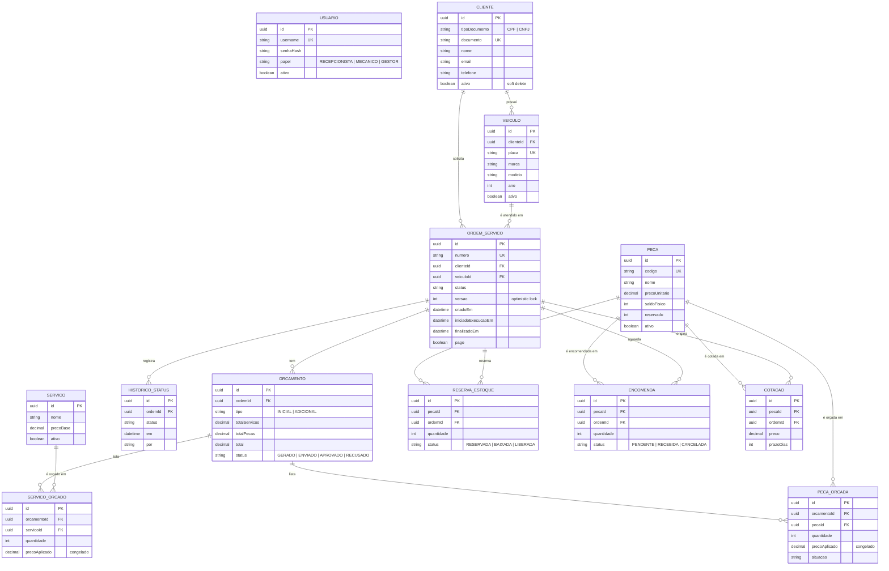

# Banco de dados — justificativa, modelo relacional e operação na nuvem

Documento da Fase 3 que reúne a **justificativa formal do banco**, o **diagrama ER** com a explicação
dos relacionamentos e os **ajustes no modelo relacional** para a nuvem. A decisão original está no
[ADR 0001](adr/0001-escolha-do-banco-de-dados.md); a infraestrutura, no repositório
[`oficina-infra-db`](https://github.com/madurubini/oficina-infra-db).

## 1. Justificativa formal

### Decisão

**PostgreSQL 16 gerenciado pelo Amazon RDS**, acessado pela aplicação via Prisma e pela Lambda de
autenticação (que só lê a tabela `cliente`).

### Por que um banco relacional

O domínio é relacional por natureza: cliente tem veículos, veículo tem ordens de serviço, ordem tem
orçamentos, orçamento tem linhas que apontam para o catálogo e para o estoque. Além disso, o núcleo
(agregado `OrdemServico`) exige garantias que um banco relacional dá de fábrica:

| Exigência do domínio | Recurso do Postgres que atende |
|---|---|
| Persistir o agregado inteiro de uma vez (OS + histórico + orçamentos + linhas) | Transação ACID multi-tabela |
| Duas pessoas não podem editar a mesma OS ao mesmo tempo | Optimistic lock (`UPDATE ... WHERE id = ? AND versao = ?`) |
| Uma peça não pode ser reservada duas vezes | `UPDATE` condicional atômico sob MVCC, sem lock pessimista |
| Dinheiro sem erro de arredondamento | `NUMERIC(10,2)` |
| Placa, CPF/CNPJ e código de peça únicos | Constraints `UNIQUE` no próprio banco |
| Linha de orçamento sempre aponta para uma peça/serviço existente | Chaves estrangeiras |

### Por que PostgreSQL (e não outro)

| Alternativa | Por que não |
|---|---|
| **MySQL / MariaDB** | Também atenderia (relacional e ACID). O Postgres tem tipos mais ricos (`uuid` nativo, `NUMERIC`, `JSONB`), índices parciais e a integração mais madura com o Prisma. Escolha de afinidade, não de impedimento. |
| **MongoDB / DynamoDB** | Guardar a OS como um documento é tentador, mas o domínio pede joins (OS × cliente × veículo, relatórios por status) e integridade entre tabelas. Modelar isso em documentos traria complexidade sem ganho. |
| **Amazon Aurora PostgreSQL** | Compatível com o Postgres, mas a menor instância custa várias vezes mais que um `db.t3.micro`. Sem justificativa para o volume da oficina. |

### Por que gerenciado (RDS) e não um Postgres dentro do Kubernetes

Na Fase 2 o banco era um StatefulSet no cluster. Na Fase 3 ele passa para o RDS porque:

- **A AWS cuida da operação**: backup diário automático com restauração a qualquer segundo
  (*point-in-time recovery*), atualização de versão menor, disco e monitoramento básico.
- **O banco sobrevive ao cluster**: recriar ou atualizar o EKS não coloca os dados em risco.
- **Isolamento de rede**: o banco não tem IP público e só aceita conexões dos nós do EKS e das
  Lambdas (security groups). Testado em 2026-10-21: de dentro do cluster conecta; de fora da AWS o
  endereço resolve para IP privado e não conecta.
- **Acesso da Lambda**: a função serverless de autenticação consulta o cliente direto no banco,
  o que é simples com um endpoint gerenciado dentro da VPC.

### Configuração escolhida: laboratório × produção

O projeto roda no AWS Academy Learner Lab (US$ 50 de saldo, sessões de ~4 h). A configuração prioriza
custo e a rotina **subir → testar → derrubar**. Numa operação real, os valores mudariam assim:

| Parâmetro | Laboratório (atual) | Produção real | Por quê |
|---|---|---|---|
| Instância | `db.t3.micro` | `db.t4g.small` ou maior | Mais CPU/memória para picos |
| `multi_az` | `false` | `true` | Uma réplica em outra zona assume em ~1 min se a principal cair |
| `backup_retention_period` | 1 dia | 7 a 35 dias | Janela maior para desfazer um erro (ex.: `DELETE` sem `WHERE`) |
| `deletion_protection` | `false` | `true` | Ninguém apaga o banco por engano |
| `skip_final_snapshot` | `true` | `false` | Se o banco for apagado, a AWS tira uma última cópia antes |
| Ciclo de vida | sobe e é derrubado a cada sessão | fica sempre ligado | — |

**Backup não é alta disponibilidade**: backup protege contra perda de *dados*; Multi-AZ protege contra
o banco *fora do ar*. Produção real teria os dois.

## 2. Modelo relacional (diagrama ER)

O monolito usa **um único database** (`oficina`). No código, cada contexto delimitado só enxerga as
próprias tabelas (nenhum módulo importa repositório de outro), mas no banco as chaves estrangeiras
entre contextos existem e garantem a integridade.

O schema completo, com todos os campos e índices, está em [`schema.prisma`](schema.prisma).

### Explicação dos relacionamentos, por contexto

**Identidade** — `usuario` é isolado: guarda os funcionários (gestor, recepcionista, mecânico) que
entram com usuário e senha. Não tem FK para outras tabelas.

**Clientes e Veículos**
- `cliente` 1 : N `veiculo` — um cliente pode ter vários carros; cada carro pertence a um cliente.
- `documento` (CPF ou CNPJ) e `placa` são únicos. Na Fase 3, o `documento` é também a chave de login
  do cliente pela Lambda `auth-cpf`.
- Exclusão é lógica (`ativo = false`): o histórico de OSs continua apontando para o cliente.

**Ordem de Serviço (núcleo)**
- `cliente` 1 : N `ordem_servico` e `veiculo` 1 : N `ordem_servico` — a OS guarda os dois porque o
  carro pode trocar de dono, e a OS precisa lembrar quem era o cliente na época.
- `ordem_servico` 1 : N `historico_status` — cada transição da máquina de estados vira uma linha com
  data/hora. Atende o acompanhamento do cliente, a auditoria e as métricas de tempo por status.
- `ordem_servico` 1 : N `orcamento` — um `INICIAL` (diagnóstico) e zero ou mais `ADICIONAL`
  (reparos descobertos na execução), cada um aprovado ou recusado de forma independente.
- `orcamento` 1 : N `servico_orcado` e 1 : N `peca_orcada` — as linhas do orçamento. Guardam
  `precoAplicado` (**preço congelado**): mudar o preço no catálogo ou no estoque não altera um
  orçamento já enviado.
- Persistência do agregado: dentro de uma transação, o repositório apaga e recria os filhos
  (linhas → orçamentos → histórico) respeitando a ordem das FKs.

**Catálogo de Serviços**
- `servico` 1 : N `servico_orcado` — o catálogo é a origem do serviço; a linha orçada guarda o
  snapshot do nome e do preço.

**Estoque**
- `peca` 1 : N `peca_orcada` — mesma lógica do catálogo.
- `peca` N : N `ordem_servico`, por três tabelas associativas com significado próprio:
  - `reserva_estoque` — a peça separada para a OS (`RESERVADA` → `BAIXADA` ao usar, ou `LIBERADA`
    se a OS cair). O saldo disponível é `saldoFisico - reservado`.
  - `encomenda` — a peça em falta pedida para a OS; quando a entrada no estoque chega, ela diz qual
    OS estava esperando e a OS sai de "Aguardando peça".
  - `cotacao` — preço e prazo do fornecedor para uma peça em falta.

## 3. Ajustes no modelo relacional para a Fase 3

| # | Ajuste | Motivo | Etapa do plano |
|---|---|---|---|
| 1 | **Um schema por ambiente** no mesmo database: `homolog` e `prod` (`DATABASE_URL` termina em `?schema=homolog` ou `?schema=prod`) | Separa os dados dos dois ambientes sem pagar duas instâncias RDS | Etapa 3 |
| 2 | **Login do cliente pelo `documento`**: a Lambda busca `cliente` por `documento` com `tipoDocumento = 'CPF'` e `ativo = true` | Requisito de autenticação por CPF. O `UNIQUE` em `documento` já cria o índice, então a busca é direta, sem tabela nova | Etapas 4 e 5 |
| 3 | **Usuário somente-leitura para a Lambda** (`oficina_auth`, com `GRANT SELECT ON <schema>.cliente`) ✅ | A Lambda só precisa ler o cliente. Com um usuário restrito, um problema na função não consegue alterar nem apagar dados (menor privilégio) | Etapa 5 |
| 4 | **Índices para os dashboards**: `ordem_servico(criadoEm)` para "OS por dia" e `historico_status(status, em)` para "tempo médio por status" | As consultas dos dashboards agregam por data e por status; sem índice, varrem a tabela inteira | Etapa 6 |

O ajuste 4 será aplicado (no `prisma/schema.prisma` e em `docs/schema.prisma`) na etapa indicada;
este documento registra a decisão.

### Como o ajuste 3 foi implementado

O usuário não faz parte do modelo (não está no `schema.prisma`): é um papel do Postgres, criado
pelo repositório `oficina-lambda-auth`.

- **Quem cria:** o pipeline do `oficina-lambda-auth`, a cada deploy, roda o Job
  [`k8s/usuario-leitura.yaml`](https://github.com/madurubini/oficina-lambda-auth/blob/main/k8s/usuario-leitura.yaml)
  no namespace do ambiente. O Job roda dentro do cluster porque o runner do GitHub não alcança o
  RDS, que só aceita conexões da VPC. Ele entra com o usuário administrador (`DB_PASSWORD`) só
  para isso.
- **O que o Job faz** (idempotente, pode rodar de novo sem erro):
  1. cria o papel `oficina_auth` com `LOGIN`, se ainda não existir, e (re)define a senha com o
     secret `DB_PASSWORD_LEITURA`;
  2. `GRANT USAGE ON SCHEMA <ambiente>`, para enxergar o schema do ambiente (`homolog` ou `prod`);
  3. `GRANT SELECT ON <ambiente>.cliente`, e nada mais.
- **Quem usa:** a Lambda `auth-cpf` conecta como `oficina_auth`. A senha chega como parâmetro
  `NoEcho` do SAM, que vira variável de ambiente da função.
- **Resultado:** um papel só, com leitura na tabela `cliente` dos dois schemas. Qualquer
  `INSERT`, `UPDATE`, `DELETE` ou leitura de outra tabela é recusado pelo próprio Postgres.

Clientes com CNPJ continuam existindo para abrir OS, mas não fazem login pela Lambda, porque o
enunciado pede autenticação por CPF.
